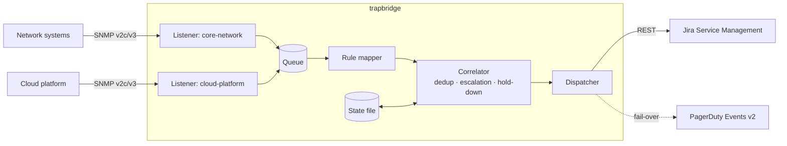

# snmp-trap-jira-bridge

[](https://github.com/ebrahimsidat/snmp-trap-jira-bridge/actions/workflows/ci.yml)


**trapbridge** receives SNMP traps from network and infrastructure systems and turns them into
well-formed **Jira Service Management** requests — without opening a ticket for every trap.
It runs alongside an existing fault-management system, so it adds automated ticketing and paging
without changing the current alarm path.

## Why it exists

Network elements emit large volumes of traps. Forwarding each one to a ticketing system creates
duplicate tickets, flapping open/close cycles during reboots, and noise that slows incident response.
trapbridge applies the correlation rules a Network Operations Centre would apply by hand:

| Problem | How trapbridge handles it |
|---|---|
| Trap storms create duplicate tickets | **One incident per node.** Repeats attach to the open ticket as rate-limited comments. |
| Reboots cause open/close/open churn | **Clear hold-down.** A clear only resolves the ticket if the problem does not return within the hold-down window. |
| A problem gets worse after the ticket opens | **Escalation tracking.** Severity increases are always recorded on the ticket. |
| Jira field configuration drifts | **Self-healing requests** drop a rejected field and retry; **start-up validation** reports mismatches before the first alert. |
| Jira is unavailable during an outage | **PagerDuty fail-over** pages on-call immediately, and the ticket is created once Jira recovers. |
| Service restarts lose context | **State persistence** keeps open incidents and ticket mappings across restarts. |

## Architecture



See [docs/architecture.md](docs/architecture.md) for the design decisions behind each component.

## Features

- SNMP **v2c and v3** (SHA-2 authentication, AES privacy) on multiple listeners, with traps attributed to the listener that received them
- Declarative **rules**: match by trap OID (longest prefix wins), set severity, build summaries from varbinds, and take the host name from a varbind when the sender is a manager rather than the affected node
- Correlation: node-level de-duplication, rate-limited repeat comments, escalation notes and flap dampening
- Jira Service Management integration: request creation, comments and resolution by workflow transition; Cloud (email + API token) and Data Center (personal access token)
- Retries with exponential back-off on HTTP 429/5xx, honouring `Retry-After`
- PagerDuty Events API v2 fail-over, with one PagerDuty incident per node
- Secrets resolved from environment variables only; nothing sensitive in configuration files
- Structured JSON logging, a hardened systemd unit and a non-root container image
- 39 automated tests, including an end-to-end test that sends a real SNMP trap over UDP

## Quick start

```bash
python3 -m venv .venv && source .venv/bin/activate
pip install -e ".[dev]"

cp config/example.yaml config/local.yaml          # edit listeners, rules and Jira settings
export TRAPBRIDGE_COMMUNITY=... JIRA_EMAIL=... JIRA_API_TOKEN=...   # see deploy/systemd/trapbridge.env.example

trapbridge --config config/local.yaml --check     # validate configuration
trapbridge --config config/local.yaml             # run
```

Send a test trap with Net-SNMP:

```bash
snmptrap -v 2c -c "$TRAPBRIDGE_COMMUNITY" 127.0.0.1:1162 '' \
  1.3.6.1.6.3.1.1.5.3 1.3.6.1.2.1.2.2.1.1 i 3
```

## Configuration

All settings live in one YAML file; [config/example.yaml](config/example.yaml) documents every option.
A rule looks like this:

```yaml
rules:
  - name: node-unreachable
    trap_oid: 1.3.6.1.4.1.99999.1.1
    severity: critical
    summary: "Node {host} unreachable"
    host_varbind: 1.3.6.1.4.1.99999.1.2.1   # take the node name from the trap payload
  - name: node-reachable
    trap_oid: 1.3.6.1.4.1.99999.1.2
    severity: info
    summary: "Node {host} reachable again"
    clear: true
    host_varbind: 1.3.6.1.4.1.99999.1.2.1
```

Summary placeholders: `{host}`, `{sender}`, `{listener}`, `{trap_oid}`, `{rule}`, and any varbind by its OID.

## Deployment

**systemd (RHEL / Rocky / Alma):**

```bash
sudo useradd --system --no-create-home --shell /sbin/nologin trapbridge
sudo python3 -m venv /opt/trapbridge/venv
sudo /opt/trapbridge/venv/bin/pip install .
sudo install -d -m 0750 -o root -g trapbridge /etc/trapbridge
sudo install -m 0640 -o root -g trapbridge config/example.yaml /etc/trapbridge/config.yaml
sudo install -m 0640 -o root -g trapbridge deploy/systemd/trapbridge.env.example /etc/trapbridge/trapbridge.env
sudo install -m 0644 deploy/systemd/trapbridge.service /etc/systemd/system/
sudo systemctl daemon-reload && sudo systemctl enable --now trapbridge
sudo firewall-cmd --permanent --add-port=1162/udp && sudo firewall-cmd --reload
```

The unit runs as an unprivileged user with an extensive systemd sandbox, and validates its configuration
before every start.

**Container:**

```bash
docker build -t trapbridge .
docker run -d --name trapbridge -p 1162:1162/udp \
  -v "$PWD/config/local.yaml:/etc/trapbridge/config.yaml:ro" \
  --env-file deploy/systemd/trapbridge.env.example trapbridge
```

Day-two operations (log reading, testing rules, recovering from a Jira outage) are covered in
[docs/operations.md](docs/operations.md).

## Development

```bash
make install   # editable install with development tools
make check     # ruff lint + format check, mypy --strict, pytest
```

Continuous integration runs linting, strict type checking, the test suite on Python 3.10–3.13,
a security scan (bandit and pip-audit) and a container build on every push and pull request.

## Project status and roadmap

Version 1.0 is feature-complete for SNMP-to-Jira ticketing. Planned work is tracked in
[docs/ROADMAP.md](docs/ROADMAP.md), including Prometheus metrics, automated remediation
playbooks and additional ticketing back-ends.

## License

Released under the [MIT License](LICENSE). © 2026 Ebrahim Sidat.
