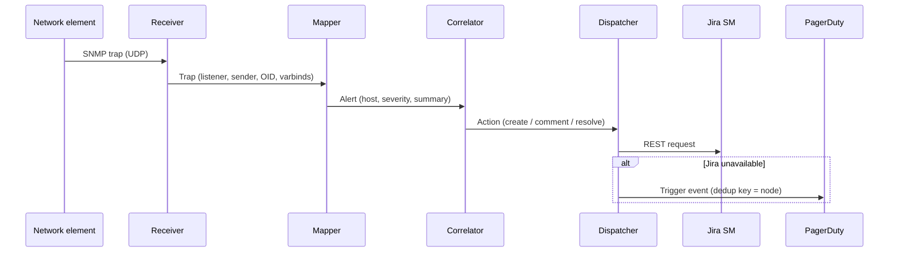

# Architecture and design decisions

## Processing pipeline

| Component | Module | Responsibility |
|---|---|---|
| Receiver | `receiver.py` | pysnmp asyncio engine; one UDP transport per listener; v2c communities and v3 USM users |
| Mapper | `mapper.py` | Selects the most specific rule for a trap OID and renders the alert summary |
| Correlator | `correlator.py` | Pure, clock-injected state machine for de-duplication, escalation and hold-down |
| Dispatcher | `dispatcher.py` | Maps incidents to tickets and routes actions to Jira, failing over to PagerDuty |
| Jira client | `jira.py` | Retries, self-healing field handling and start-up validation |
| Application | `app.py` | Wiring, signal handling, periodic hold-down polling and state persistence |

## Key decisions

### ADR-1: Correlate at node level

**Decision:** one open incident per `listener:host`, not per trap type.
**Reason:** when a node fails it typically emits many different traps. Operations teams act on the node,
so a single ticket that collects all related events is easier to work and reduces duplicate tickets.
**Trade-off:** two unrelated faults on the same node share a ticket; the comment history keeps them distinguishable.

### ADR-2: Hold down clears instead of resolving immediately

**Decision:** a clear starts a timer (default 120 seconds); the ticket resolves only if no new alert arrives in that window.
**Reason:** reboots and link flaps produce rapid down/up/down sequences. Resolving on the first clear would
close and re-open tickets and page on-call repeatedly.

### ADR-3: Keep the correlator pure

**Decision:** the correlator performs no I/O and receives the current time as an argument.
**Reason:** correlation is the logic most likely to contain subtle errors; keeping it pure makes every
timing scenario reproducible in fast unit tests.

### ADR-4: Degrade gracefully when Jira rejects a field

**Decision:** on HTTP 400 naming specific fields, drop those fields (never the summary) and retry once.
**Reason:** request-type configuration in Jira changes independently of this service. Creating a ticket with
slightly less metadata is better than losing the alert. Start-up validation surfaces the drift so it can be fixed.

### ADR-5: Page through PagerDuty when Jira is down

**Decision:** if ticket creation fails after retries, trigger a PagerDuty event and retry ticket creation on the
next update for that incident.
**Reason:** an outage of the ticketing system must never prevent on-call from being notified about a network fault.

### ADR-6: Secrets only from the environment

**Decision:** configuration values written as `${VAR}` are resolved from the environment; a missing variable stops start-up.
**Reason:** keeps credentials out of version control and configuration management, and fails loudly instead of
starting with an empty password.

## Security considerations

- Runs as an unprivileged user; binding to udp/162 uses `CAP_NET_BIND_SERVICE` only
- systemd sandboxing: read-only file system, private `/tmp`, restricted address families and system calls
- SNMPv3 with SHA-2 and AES is supported and recommended over v2c communities
- Dependencies are scanned with `pip-audit` and source with `bandit` on every change
- Ticket content is limited to trap data; no credentials or configuration are ever written to Jira or logs
